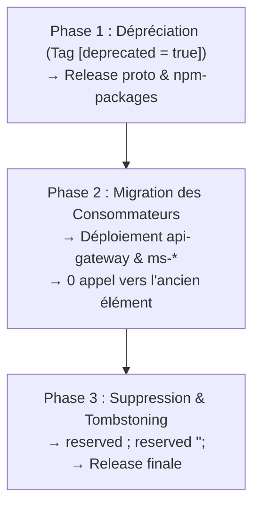

# Cycle de Dépréciation Protobuf & Tombstoning gRPC

## Quand utiliser ce playbook

Utiliser ce playbook pour toute suppression ou renommage d'un champ protobuf (`message`), d'une valeur d'énumération (`enum`) ou d'une méthode de service (`rpc`) dans `proto-registry`.

> [!CAUTION]
> **Interdiction formelle de suppression directe** : Supprimer ou renuméroter immédiatement un tag protobuf corrompt la sérialisation binaire wire gRPC des services en production qui tournent avec l'ancienne version du contrat[^contrats].

---

## Les 3 Phases de Dépréciation



---

### Phase 1 : Marquage et Annonce (Dépréciation Wire-Safe)

Dans `proto-registry` :
1. Conserver le champ et son numéro de tag inchangés.
2. Ajouter l'option officielle Protobuf `[deprecated = true];` :
   ```protobuf
   // Ancien champ déprécié au profit de `new_field` (tag 6)
   string old_field = 4 [deprecated = true];
   ```
3. Pour une méthode RPC dépréciée :
   ```protobuf
   rpc OldMethod(OldRequest) returns (OldResponse) {
     option deprecated = true;
   }
   ```
4. Valider en local la syntaxe et la non-régression binaire[^buf] :
   ```bash
   cd proto-registry
   buf lint
   buf breaking --against '.git#branch=main'
   ```
5. **🛑 RÈGLE DU STOP IMMÉDIAT** :
   - Ouvrir la PR sur `proto-registry`.
   - Attendre le merge sur `main`.
   - La CI déclenche la génération automatique de la PR dans `npm-packages` via `proto-sync.yml`[^proto-sync].
   - La PR dans `npm-packages` est mergée et publiée sur le registre NPM privé.

---

### Phase 2 : Migration et Extinction des Consommateurs

Une fois le package `@volontariapp/contracts` publié avec les avertissements de dépréciation :
1. Cartographier l'intégralité des consommateurs dans le workspace via l'outil MCP :
   ```json
   analyze_grpc({ "target": "NomDuServiceOuRPC" })
   ```
2. Mettre à jour `api-gateway` et les microservices (`ms-*`) :
   - Mettre à jour la dépendance : `yarn up @volontariapp/contracts @volontariapp/contracts-nest`.
   - Adapter le code métier pour lire et écrire exclusivement le nouveau champ ou appeler le nouveau RPC.
   - Ne plus instancier ni référencer le champ déprécié.
3. Déployer en staging puis en production.
4. **Période d'observation** : Vérifier sur Datadog qu'aucun client ne transmet plus l'ancien champ ou n'appelle l'ancienne méthode RPC pendant au moins un cycle de déploiement complet.

---

### Phase 3 : Suppression Définitive et Tombstoning (`reserved`)

Une fois garanti qu'aucun consommateur n'utilise plus l'élément déprécié :
1. Dans `proto-registry`, supprimer la ligne du champ déprécié.
2. **Ajouter impérativement les directives de réservation (`reserved`)** pour interdire à tout jamais la réutilisation du tag ou du nom (évite les collisions catastrophiques avec les anciens payloads stockés ou en transit)[^contrats] :
   ```protobuf
   message MonMessage {
     reserved 4;
     reserved "old_field";

     string id = 1;
     string title = 2;
     // ...
   }
   ```
3. Pour un enum, réserver le numéro de valeur :
   ```protobuf
   enum MonEnum {
     reserved 2;
     reserved "OLD_VALUE";
     
     MON_ENUM_UNSPECIFIED = 0;
     MON_ENUM_ACTIVE = 1;
   }
   ```
4. Valider localement :
   ```bash
   cd proto-registry
   buf lint
   buf breaking --against '.git#branch=main'
   ```
5. **🛑 RÈGLE DU STOP IMMÉDIAT** : Laisser la cascade de CI publier la nouvelle version de `@volontariapp/contracts` sans le symbole déprécié.
6. Mettre à jour les microservices finaux (`yarn up`).

---

## Checklist de validation

- [ ] L'élément a d'abord passé un cycle complet avec `[deprecated = true]` avant toute suppression.
- [ ] L'outil MCP `analyze_grpc` confirme que plus aucun microservice ni passerelle n'appelle l'élément déprécié.
- [ ] Le numéro de tag supprimé est consigné dans `reserved <n>;`[^contrats].
- [ ] Le nom du champ supprimé est consigné dans `reserved "<nom>";`.
- [ ] `buf lint` et `buf breaking --against '.git#branch=main'` passent sans erreur[^buf].
- [ ] La règle du STOP a été scrupuleusement respectée à chaque passage dans `proto-registry`[^proto-sync].

---

## Références

[^buf]: proto-registry/buf.yaml
[^contrats]: docs/stockage-fichiers/08-contrats-et-evolutions.md
[^proto-sync]: ci-tools/.github/workflows/proto-sync.yml
