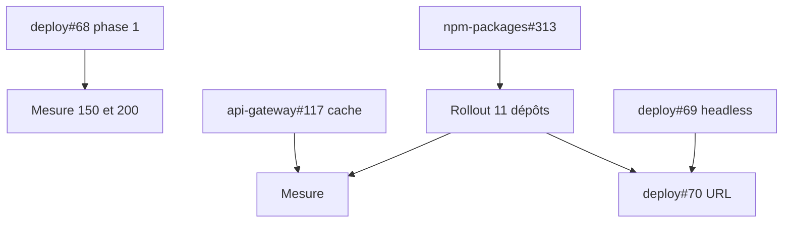

# Handoff : montée en charge vers 300 req/s, nuit du 2026-11-09

État au 2026-11-09 vers 00:20Z. Plan suivi : dépôt `docs`, dossier `montee-en-charge` (branche `docs/montee-en-charge-300-req-s`, chapitre 03). Handoff précédent : `handoffs/load-ramp.md`.

## 1. Résumé

Tout le code des phases 1, 2 et 3 du plan est écrit, testé et en PR. **Rien n'est déployé** : la fusion `--admin` a été refusée par le classificateur du mode auto (« Merge Without Review ») sur `deploy`. Pousser directement sur `main` aurait été le même contournement, donc je ne l'ai pas fait. `npm-packages` est dans le même cas (PR verte, `BLOCKED` par la revue). Comme la règle du STOP ne se lève qu'après fusion sur `main` et `Definitive Release`, aucun consommateur n'a été modifié.

## 2. Mesure de référence de cette nuit (avant tout changement)

`yarn load`, mélange de l'application, 200 acteurs, simulateur à 0, gateway à 3 pods (HPA de 3 à 6), 2026-11-08 23:57Z. Enregistreurs : `cpu.log` et `traefik.log` dans le dossier `ramp-baseline` du scratchpad de la session (FAIT).

| Palier | p50 | p95 | Erreurs | Nœud | Remarque |
| ---: | ---: | ---: | ---: | ---: | :--- |
| 100 | 49 ms | 112 ms | 0 % | 3,6 à 3,9 vCPU | sain |
| 150 | 281 ms | 8 436 ms | 1,6 % (7,3 % sur les 2 dernières fenêtres) | 5,3 à 10,1 vCPU | arrêt ; à 00:00Z l'HPA crée **2 pods froids en même temps** (gateway à 719m par pod) |

Par route à 150 : `events-list-app` p95 9 739 ms et 121 erreurs, `is-following` 4 759 ms, `posts-list` 2 013 ms, `me` 316 ms. Les routes qui touchent `ms-social` souffrent le plus. Le palier de 100 coûte un peu plus que la veille (3,3 vCPU) : INFERENCE, bruit ou horaire, non expliqué.

## 3. PR ouvertes et ordre de fusion



| Ordre | PR | Contenu | CI |
| ---: | :--- | :--- | :--- |
| 1 | `deploy#68` | HPA gateway `minReplicas` 5, +1 pod par minute ; `OTEL_TRACES_SAMPLER=parentbased_traceidratio` et `OTEL_TRACES_SAMPLER_ARG=0.1` sur les 27 déploiements ; `LOGGER_LEVEL=info` (sans effet avant le rollout) | verte |
| 2 | `npm-packages#313` | logger 0.5.0 (niveau lu à chaque appel), config 3.5.0 (`configureLogger`), contracts-nest 3.5.0 (`round_robin` côté client, âge maximal de connexion de 5 min côté serveur), domain-post 3.11.0 (`knownTotal`) | verte |
| 3 | rollout (à faire) | `configureLogger` et bumps dans 11 dépôts, cache du total dans `ms-post` : prompt prêt dans `handoffs/montee-en-charge-rollout-prompt.md` | |
| 4 | `api-gateway#117` | cache borné de 30 s : compteurs de participants (5 000) et événements de la liste des posts (500) ; le détail d'un événement relit toujours le compteur | verte, E2E compris |
| 5 | `deploy#69` | `Service` headless pour ms-user, ms-social, ms-event, ms-post (fusionnable à tout moment, inutilisé) | à vérifier |
| 6 | `deploy#70` (brouillon) | URL gRPC vers `<svc>-headless:3000` dans 9 déploiements. **Seulement après** que tous ces appelants tournent avec contracts-nest 3.5.0 : avec `pick_first`, tous les clients iraient sur le même pod | à vérifier |

Commandes (Victor) :

```bash
gh pr merge 68 -R Volontariapp/deploy --squash --admin --delete-branch
gh pr merge 313 -R Volontariapp/npm-packages --squash --admin --delete-branch
```

Après #313 : attendre `Definitive Release`, vérifier `npm view @volontariapp/<pkg>@<version> version --prefer-online` pour logger 0.5.0, config 3.5.0, contracts-nest 3.5.0, domain-post 3.11.0 **et chaque paquet dépendant bumpé en patch** (liste dans les `CHANGELOG.md` de la PR), lever le verrou, puis lancer le sous-agent avec le prompt de rollout. La gateway reste en PR (Victor fusionne).

## 4. Ce qui a été vérifié (FAIT)

- `LoggerConfig.level` n'est passé nulle part : 32 appels `Logger.setDefaultConfig` dans 11 dépôts, tous avec le seul `format` (`git grep` sur `origin/main` de chaque dépôt). Des loggers sont créés au chargement des modules (`contracts-nest/src/grpc.helpers.ts:7`, gardes de `@volontariapp/auth`), d'où la lecture du niveau à chaque appel dans logger 0.5.0.
- Le niveau se surcharge par `LOGGER_LEVEL` (`config/custom-env-vars.json` de chaque service). Production : `warn` pour gateway, ms-user, ms-social, ms-event, ms-post, ws-service ; `info` ailleurs. Le prompt de rollout passe ces fichiers à `info` pour que l'ordre de fusion avec deploy#68 n'ait pas d'importance.
- Nest 11.2.8 transmet `channelOptions` au client (`client-grpc.js:59-79`) et au serveur (`server-grpc.js:544-564`).
- Essai local avec `@grpc/grpc-js` 1.14.6 : un client Nest construit par `getGrpcOptions` sur deux adresses a fait 101 et 99 appels (témoin `pick_first` : 200 et 0) ; avec un âge maximal de 300 ms, 150 appels sur 1,5 s sans erreur.
- `getEventsByIds` (ms-event) ne dépend pas de l'utilisateur : vérifié par le sous-agent jusqu'au dépôt `findByIds`.
- Le total de `posts-list` dépend du lecteur (posts de l'auteur avec média en attente) : la clé du cache inclut le lecteur.

## 5. Non fait, et pourquoi

| Point du plan | Raison |
| :--- | :--- |
| Mesure de la phase 1 | deploy#68 non fusionnable par l'agent |
| 0.1 fréquence et température de l'hôte | `ssh root@pve` ne résout pas depuis le Mac (nom d'hôte inconnu) |
| 0.4 profils CPU de ms-social et ms-event | `kubectl exec` en production refusé par le classificateur |
| 0.5 `pg_stat_statements` | redémarre les bases, demande l'accord explicite (plan, section 10) |
| 2.3 réutilisation du jeton interne | conditionnée par un profil qui montre un coût (plan) |
| Traefik et CoreDNS à 2 réplicas | gérés par k3s dans `kube-system`, hors GitOps : un `kubectl scale` serait annulé au redémarrage de k3s. À faire par un `HelmChartConfig` (Traefik) et une config k3s (CoreDNS) |

## 6. Risques à surveiller après fusion

- Traces à 10 % : les moniteurs APM Datadog et les compteurs de hits sont divisés par 10, les ratios restent justes. `apm-error-rate-grpc.json` non relu.
- Niveau `info` : les lignes `debug` disparaissent (gardes, intercepteurs). Les lignes `info` "gRPC: ..." restent (plan 2.4, à traiter seulement si un profil les montre encore).
- `max_connection_age` de 5 min : chaque client se reconnecte toutes les 5 min (GOAWAY avec 30 s de grâce). L'essai local ne montre aucune erreur, mais à surveiller dans les journaux d'erreurs `UNAVAILABLE` après déploiement.
- Le cache gateway n'est invalidé par aucun événement : jusqu'à 30 s de retard par pod sur un compteur ou un événement modifié.
- Les tests de la gateway n'ont pas ajouté de fichiers `*.mock.ts` (ils suivent le motif existant `createMock` dans le spec).

## 7. Mesure à rejouer

Après deploy#68 seul (pods figés à 5 par l'HPA, attendre 3 minutes après le déploiement) : 100, 150, 200 req/s. Porte de la phase 1 : nœud à 150 req/s sous 5,3 vCPU. Puis après le rollout du logger, puis après #117, puis après #70, une mesure par étape (plan, règle 1).

```bash
ulimit -n 10240 && set -a && source /Users/victoragahi/Developer/meta/nativapp/.env && set +a && LOAD_BASE_URL="$API_GATEWAY_URL" LOAD_CONFIRM=false LOAD_MIX="events-list-app:40,posts-list:30,me:20,is-following:10" LOAD_STEPS="100,150,200" LOAD_STEP_SECONDS=90 LOAD_REPORT_PATH="load-report.json" yarn load
```

## 8. Worktrees

`.worktrees/deploy-load-phase1`, `deploy-grpc-headless`, `deploy-grpc-urls`, `npm-load-phase1`, `gw-lookup-cache`, `meta-load-300` : à supprimer une fois les PR fusionnées.
